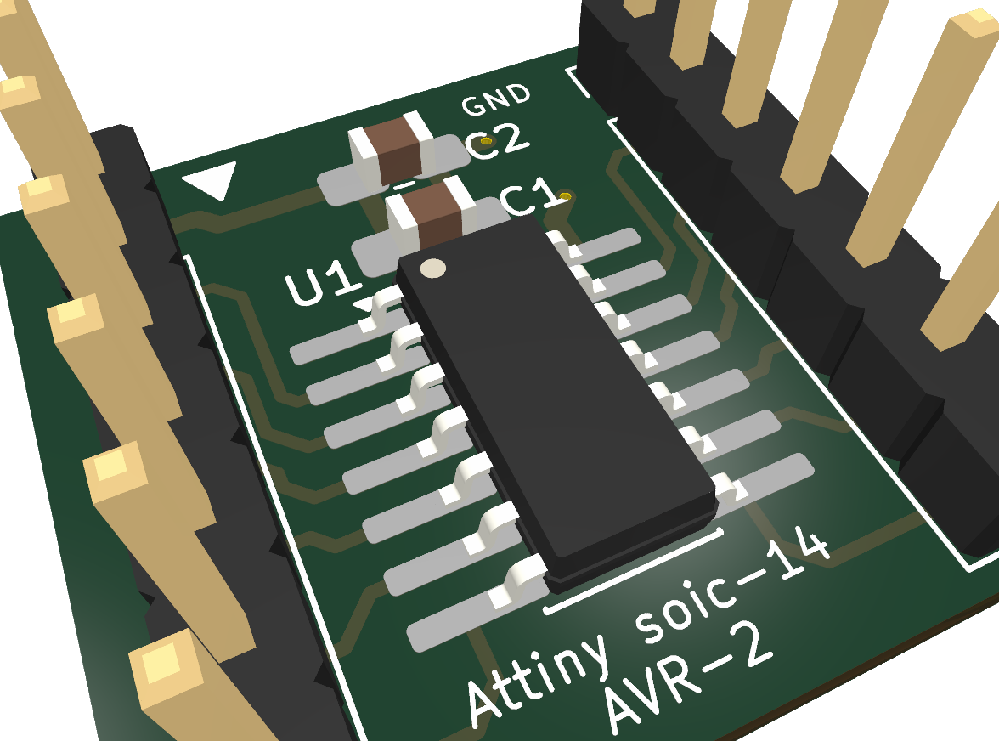
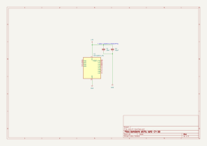
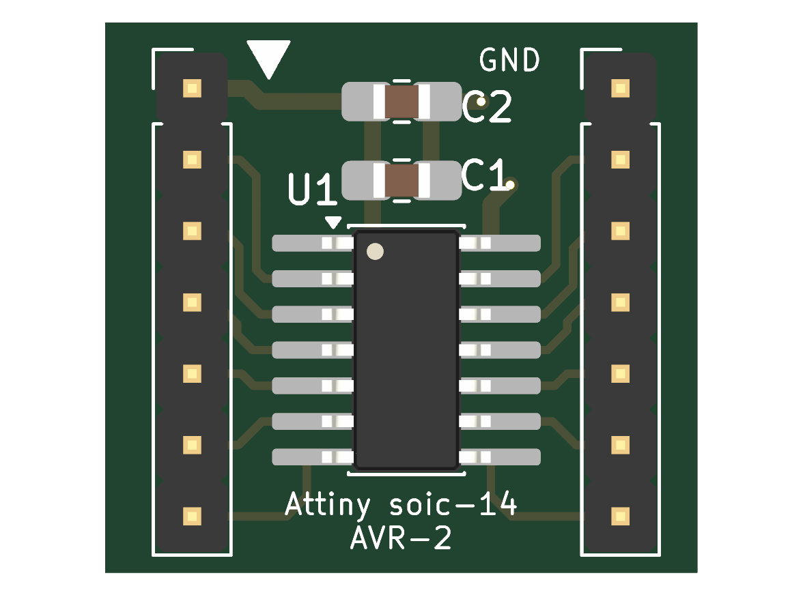
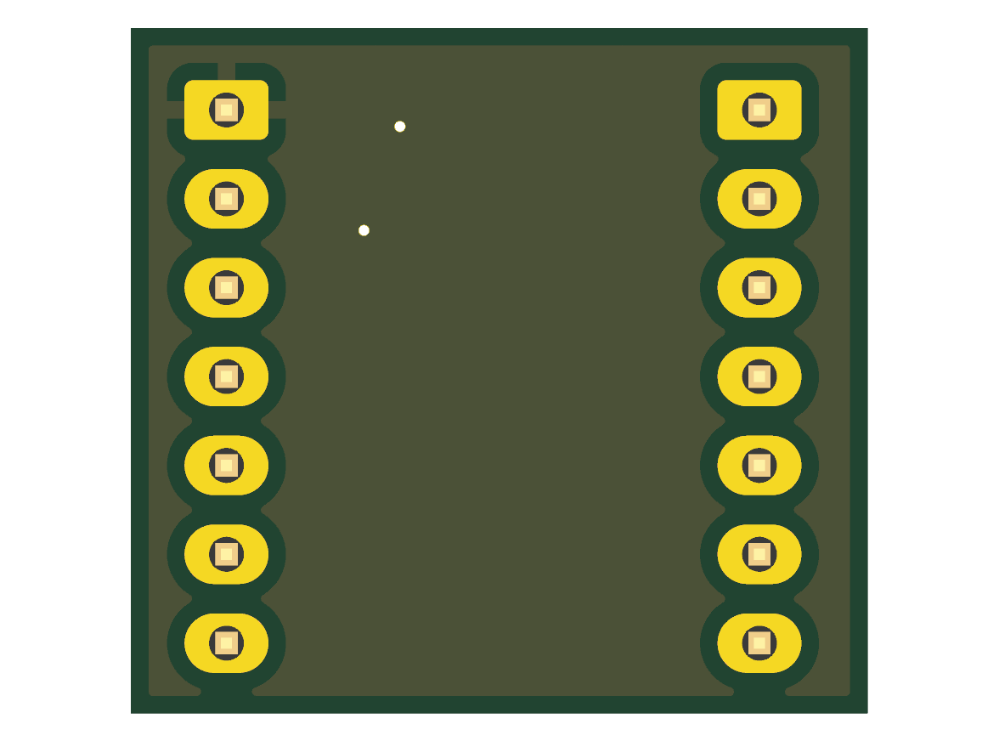

# ATtiny SOIC-14 Breadboard Breakout Board (tinyAVR-2 / 1 / 0 Series)

[](https://www.kicad.org/)
[](LICENSE)
[](https://www.oshwa.org/)
[](soic14-bb-gerbers.zip)

A compact, breadboard-friendly breakout adapter PCB for **14-pin SOIC Microchip ATtiny** microcontrollers (such as **ATtiny3224, ATtiny1624, ATtiny824, ATtiny424**, as well as 1-series and 0-series parts like **ATtiny1614, ATtiny814, ATtiny414, ATtiny404, ATtiny214, ATtiny204**).

Designed to bridge the gap between SMD SOIC-14 packaging and rapid breadboard prototyping, this board breaks out all 14 pins into a standard 600 mil DIP form factor with onboard decoupling capacitors for noise-free, stable operation.

---

## 3D Render

<p align="center">
  
</p>

---

## Features

- **Breadboard Friendly (600 mil DIP Spacing)**: The two 7-pin header rows are spaced at 15.24 mm (0.6" / 600 mil), spanning the center divider of a standard solderless breadboard while leaving tie-points accessible on both sides.
- **Onboard Power Decoupling**:
  - `C1` (**10 nF**, 0805): High-frequency ceramic decoupling capacitor.
  - `C2` (**10 µF**, 0805): Bulk electrolytic/tantalum-replacement ceramic capacitor.
  - Placed directly across $V_{DD}$ (Pin 1) and $\text{GND}$ (Pin 14) to eliminate supply ripple, reduce voltage dips, and prevent brownout resets.
- **Direct 1:1 DIP Pinout**: Headers match the physical DIP-14 pin numbering (Pins 1–7 down the left row, Pins 8–14 down the right row).
- **UPDI Programming Access**: The single-wire UPDI interface on Pin 10 (`PA0 / ~RESET / UPDI`) is broken out directly, enabling instant flashing via SerialUPDI or hardware programmers.
- **Continuous Ground Plane**: Bottom layer is an uninterrupted copper ground pour for solid signal return paths and improved EMI performance.
- **Clear Silkscreen Markings**: Pin 1 orientation triangle, component references, GND reference, and board family indicators clearly printed.

---

## Board Specifications

| Parameter | Value |
|---|---|
| **Dimensions** | 21.06 mm × 19.60 mm (0.83" × 0.77") |
| **Layers** | 2 Layers (FR-4) |
| **Row Pitch** | 15.24 mm (0.600" / 600 mil DIP) |
| **Header Pitch** | 2.54 mm (0.100") |
| **IC Footprint** | SOIC-14 (3.9 mm × 8.7 mm, 1.27 mm pitch) |
| **Passive Footprint** | 0805 Metric (2012) with hand-solder pads |
| **Copper Weight** | 1 oz (35 µm) |
| **Default Board Thickness** | 1.6 mm |

---

## Pinout & Peripheral Mapping

The breakout headers map 1:1 to the SOIC-14 IC pins. The table below lists the pin functions for the modern **ATtiny tinyAVR 2-Series** (ATtiny3224 / ATtiny1624 / ATtiny824 / ATtiny424):

```
                       +---[ SOIC-14 / DIP-14 ]---+
        VDD (+1.8V..5V) [ 1  ]                    [ 14 ] GND
      PA4 (AIN4 / TCA0) [ 2  ]                    [ 13 ] PA3 (AIN3 / EXTCLK)
     PA5 (AIN5 / VREFA) [ 3  ]                    [ 12 ] PA2 (AIN2 / USART0 RX)
      PA6 (AIN6 / TCA0) [ 4  ]                    [ 11 ] PA1 (AIN1 / USART0 TX)
     PA7 (AIN7 / EVOUT) [ 5  ]                    [ 10 ] PA0 (UPDI / ~RESET)
 PB3 (RxD / SCL / TCB0) [ 6  ]                    [  9 ] PB0 (AIN11 / CLKOUT)
 PB2 (TxD / SDA / TCA0) [ 7  ]                    [  8 ] PB1 (AIN10 / TCA0)
                        +--------------------------+
```

### Detailed Pin Table

| Header Pin | IC Pin | Primary Name | Default / Alternate Functions | Notes |
|:---:|:---:|:---|:---|:---|
| **1** | 1 | `VDD` | Power supply (+1.8V to +5.5V) | Decoupled via C1 (10nF) and C2 (10µF) |
| **2** | 2 | `PA4` | AIN4, TCA0 WO4, CCL IN0, USART0 XCK | Digital I/O / Analog input |
| **3** | 3 | `PA5` | AIN5, TCA0 WO5, CCL OUT0, VREFA | Analog reference / PWM |
| **4** | 4 | `PA6` | AIN6, TCA0 WO0, CCL IN1, AC0 OUT | Analog input / PWM |
| **5** | 5 | `PA7` | AIN7, TCA0 WO1, CCL IN2, EVOUT0 | Event output / PWM |
| **6** | 6 | `PB3` | AIN8, TCA0 WO0, TCB0 WO, USART0 RXD, TWI0 SCL | I2C SCL / UART RX |
| **7** | 7 | `PB2` | AIN9, TCA0 WO1, USART0 TXD, TWI0 SDA | I2C SDA / UART TX |
| **8** | 8 | `PB1` | AIN10, TCA0 WO2, USART0 XCK | Digital I/O / Analog input |
| **9** | 9 | `PB0` | AIN11, TCA0 WO2, CLKOUT | Clock output / Analog input |
| **10** | 10 | `PA0` | `~RESET` / `UPDI` | **Programming / Debugging pin** |
| **11** | 11 | `PA1` | AIN1, TCA0 WO1, USART0 TXD | UART Alternate TX / Analog input |
| **12** | 12 | `PA2` | AIN2, TCA0 WO2, USART0 RXD, EVOUT1 | UART Alternate RX / Analog input |
| **13** | 13 | `PA3` | AIN3, TCA0 WO3, EXTCLK | External clock input / Analog input |
| **14** | 14 | `GND` | Ground reference (0V) | Common ground plane connection |

*(Note: Pin functions are also backwards-compatible with tinyAVR 0-series and 1-series SOIC-14 microcontrollers).*

---

## Bill of Materials (BOM)

| Reference | Value | Package / Footprint | Qty | Description | Suggested Part / MPN |
|---|---|---|:---:|---|---|
| **U1** | ATtiny3224-SS | SOIC-14 (3.9x8.7mm, 1.27mm pitch) | 1 | 8-bit AVR Microcontroller (20MHz, 32KB Flash, 3KB SRAM) | `ATTINY3224-SSFR` / `ATTINY1624-SSFR` |
| **C1** | 10 nF (0.01 µF) | 0805 (2012 Metric) | 1 | Ceramic capacitor, 50V, X7R (High-frequency decoupling) | Generic 0805 10nF 50V |
| **C2** | 10 µF | 0805 (2012 Metric) | 1 | Ceramic capacitor, 10V–25V, X5R/X7R (Bulk power stabilization) | Generic 0805 10µF 16V |
| **J1, J2** | 1x07 Pin Header | 2.54 mm Pitch THT (Vertical) | 2 | 7-pin male breakaway header | Standard 2.54 mm pin header |

A CSV format BOM is also available at [`hardware_docs/bom.csv`](hardware_docs/bom.csv).

---

## Schematic & Hardware Documentation

The schematic and board were authored in **KiCad 10**.

- **Vector Schematic**: [`hardware_docs/schematic.svg`](hardware_docs/schematic.svg)
- **Printable Schematic**: [`hardware_docs/schematic.pdf`](hardware_docs/schematic.pdf)

<p align="center">
  
</p>

### Board Layout Preview

| Top Side (Components & Silkscreen) | Bottom Side (Ground Plane) |
|:---:|:---:|
|  |  |

---

## Fabrication & Ordering

Ready-to-order Gerbers and drill files are archived in **[`soic14-bb-gerbers.zip`](soic14-bb-gerbers.zip)**.

### Ordering with JLCPCB / PCBWay:
1. Download **`soic14-bb-gerbers.zip`**.
2. Upload the `.zip` file directly to the manufacturer's quote page (e.g., [JLCPCB](https://jlcpcb.com/) or [PCBWay](https://www.pcbway.com/)).
3. Select standard options:
   - **Dimensions**: ~21 mm × 19.6 mm (auto-detected)
   - **Layers**: 2
   - **PCB Thickness**: 1.6 mm
   - **Solder Mask**: Green (or your preferred color)
   - **Silkscreen**: White
   - **Surface Finish**: HASL (with lead) or Lead-Free HASL / ENIG
   - **Copper Weight**: 1 oz

Individual Gerber and Excellon drill files can also be inspected directly in [`to_pcb_providers/`](to_pcb_providers/).

---

## Programming with SerialUPDI

The ATtiny 2-series uses a single-wire UPDI interface on Pin 10 (`PA0`). You can program it easily using any USB-to-UART bridge (FTDI, CH340, CP2102) with a resistor or diode:

```
 USB-to-Serial
  Adapter                 ATtiny Breakout
+---------+              +---------------+
|     TXD |----+         |               |
|         |   [4.7kΩ]    |               |
|         |    +-------->| Pin 10 (UPDI) |
|     RXD |----+         |               |
|     GND |------------->| Pin 14 (GND)  |
|     VCC |------------->| Pin 1  (VDD)  |
+---------+              +---------------+
```

### PlatformIO Configuration Example

Using [`megaTinyCore`](https://github.com/SpenceKonde/megaTinyCore) via PlatformIO:

```ini
[env:attiny3224]
platform = atmelmegaavr
board = ATtiny3224
framework = arduino

; SerialUPDI upload configuration
upload_protocol = serialupdi
upload_port = /dev/ttyUSB0   ; Or COMx on Windows
upload_flags =
    -b
    115200
```

---

## Repository Structure

```
├── hardware_docs/              # High-resolution documentation assets
│   ├── bom.csv                 # Exported Bill of Materials
│   ├── pcb_3d.png              # 3D isometric board render
│   ├── pcb_top.png             # 2D top layer render
│   ├── pcb_bottom.png          # 2D bottom layer render
│   ├── schematic.pdf           # Printable schematic document
│   └── schematic.svg           # High-resolution vector schematic
├── to_pcb_providers/           # Pre-generated Gerber and drill files
│   ├── soic14-bb-B_Cu.gbr
│   ├── soic14-bb-B_Mask.gbr
│   ├── soic14-bb-B_Paste.gbr
│   ├── soic14-bb-B_Silkscreen.gbr
│   ├── soic14-bb-Edge_Cuts.gbr
│   ├── soic14-bb-F_Cu.gbr
│   ├── soic14-bb-F_Mask.gbr
│   ├── soic14-bb-F_Paste.gbr
│   ├── soic14-bb-F_Silkscreen.gbr
│   ├── soic14-bb-job.gbrjob
│   ├── soic14-bb-NPTH.drl
│   └── soic14-bb-PTH.drl
├── .gitignore                  # KiCad & OS ignore rules
├── LICENSE                     # MIT License
├── README.md                   # Project documentation (this file)
├── soic14-bb-gerbers.zip       # Ready-to-upload manufacturer ZIP archive
├── soic14-bb.kicad_pcb         # KiCad PCB board file
├── soic14-bb.kicad_pro         # KiCad project definition
└── soic14-bb.kicad_sch         # KiCad schematic design
```

---

## License

This project is open-source hardware licensed under the [MIT License](LICENSE).
Feel free to build, modify, fabricate, and distribute!
